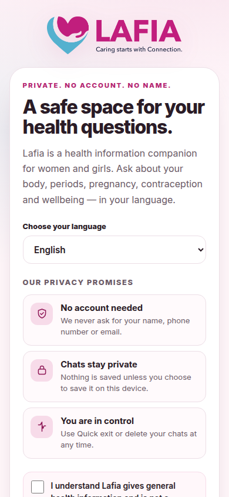
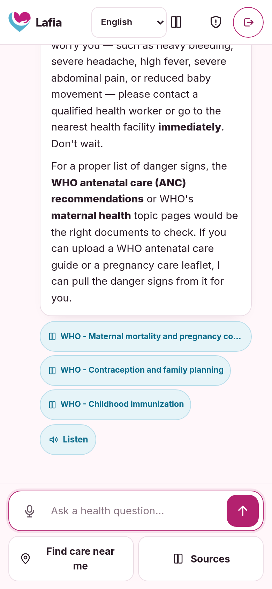
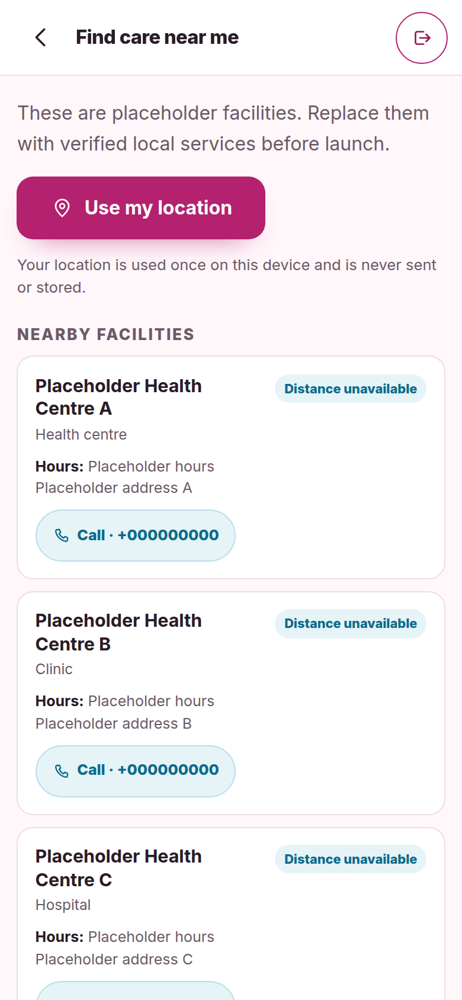
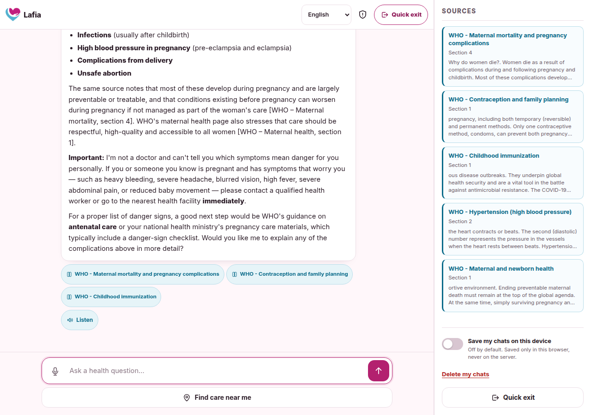
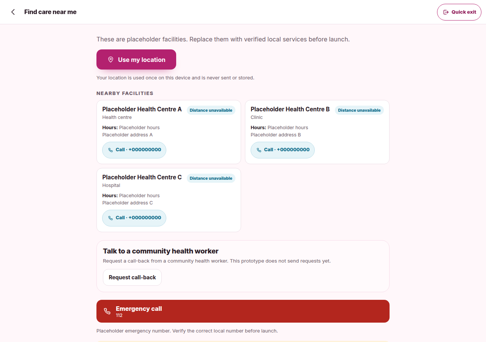

# Lafia Chat AI

**A private, source-cited health companion for women and girls.**

Lafia answers health questions in plain language from two sources:

1. documents an organisation uploads (PDF, image, SCORM or web page);
2. WHO health pages fetched at runtime (maternal health, contraception,
   menstrual health, TB, HIV, malaria, nutrition, mental health and more).

Every answer shows the passages it used and links to the WHO page or uploaded
PDF. Lafia is **not** a diagnosis tool and does not replace a health worker.

> **Prototype status.** The default flow needs no account. Chats are unsaved
> unless the user enables saving on their device. Read
> [`docs/SAFETY_AND_PRIVACY.md`](docs/SAFETY_AND_PRIVACY.md) and
> [`SECURITY.md`](SECURITY.md) before using real health data.

## Screens

| Consent | Chat (phone) | Find care (phone) |
| --- | --- | --- |
|  |  |  |

| Chat (desktop) | Find care (desktop) |
| --- | --- |
|  |  |

One codebase, three screens, responsive from 390px phones to desktop.

## What it does

- Language picker: English, Kiswahili, Luganda, Acholi, Ateso, Lusoga, with
  English fallback for missing strings.
- Required “not a diagnosis” consent before chat.
- Streaming answers with markdown, WHO/document source chips and a Listen button.
- Voice input through the browser Speech Recognition API.
- **Quick exit** button and Escape-twice shortcut using `location.replace`.
- **Find care** with one-time browser geolocation, client-side distances and
  clearly marked placeholder facilities from `data/facilities.json`.
- Desktop Sources panel and an opt-in “Save my chats on this device” switch.
- Delete-my-chats control that removes all browser-stored chat data.

## Quick start (under 10 minutes)

```bash
python3 -m venv .venv
source .venv/bin/activate
pip install -r requirements-minimal.txt
cp .env.example .env
# set LLM_API_KEY (or DEEPSEEK_API_KEY/OPENAI_API_KEY) and LLM_MODEL
uvicorn app.main:app --host 0.0.0.0 --port 8000
```

Open `http://localhost:8000`. The first WHO sync fetches pages from who.int and
may take a few seconds. Set `WHO_SYNC_ON_STARTUP=false` to skip it.

Health check:

```bash
curl http://localhost:8000/api/health
```

Optional full install with local sentence-transformers embeddings:

```bash
pip install -r requirements.txt
```

## Architecture

```
FastAPI (app/main.py)
  ├─ /api/chat          streaming RAG answer
  ├─ /api/bootstrap     documents, WHO status, suggestions
  ├─ /api/who           runtime WHO sync status
  ├─ /api/documents     upload / delete sources
  ├─ /data/facilities.json
  └─ /api/auth/*        optional Supabase scaffold (not mounted in UI)

app/services/
  retrieval.py          prompt, language instruction, streaming, citations
  who_knowledge.py      runtime WHO fetch + heading-aware chunking
  ingestion.py          PDF, OCR, SCORM, web ingestion
  embeddings.py         hash / local / OpenAI-compatible embeddings
  vectorstore.py        Chroma wrapper

templates/chat.html     three-screen shell
static/css/chat.css     design tokens and responsive layout
static/js/chat.js       i18n, chat, privacy, quick exit, find care, speech
static/i18n/*.json      one file per language
data/facilities.json    placeholder facilities (replace before launch)
```

## Configuration

| Variable | Purpose |
| --- | --- |
| `LLM_PROVIDER` | Label for your OpenAI-compatible provider. |
| `LLM_API_KEY` / `OPENAI_API_KEY` / `DEEPSEEK_API_KEY` | Provider key. |
| `LLM_BASE_URL` / `OPENAI_BASE_URL` / `DEEPSEEK_BASE_URL` | Provider base URL. |
| `LLM_MODEL` / `CHAT_MODEL` | Model name. `LLM_MODEL` wins. |
| `EMBEDDING_BACKEND` | `hash` (default), `local`, or `openai`. |
| `WHO_SYNC_ON_STARTUP` | Fetch WHO pages at boot (default `true`). |
| `SUPABASE_URL`, `SUPABASE_ANON_KEY` | Optional auth scaffold. |
| `AUTH_REQUIRED` | Gate chat behind sign-in (default `false`). |

Secrets belong in `.env`, which is gitignored. See `.env.example`.

## Privacy summary

| Promise | How it is kept |
| --- | --- |
| No account, name or phone | Chat works without auth; no sign-up UI. |
| Chats unsaved by default | Save switch defaults off; no server chat persistence. |
| Saved chats stay local | Browser `localStorage` only, never sent to the server. |
| Delete means delete | Removes the saved chat key and in-memory messages. |
| Quick exit | Clears memory, removes saved chats, `location.replace`. |
| Location stays local | One geolocation read, client-side distance, no request/storage. |
| Listen is browser-only | `speechSynthesis`; hidden when no matching voice exists. |
| No diagnosis | Prompt and UI disclaimers; urgent-care language for danger signs. |

Full verification table: [`docs/SAFETY_AND_PRIVACY.md`](docs/SAFETY_AND_PRIVACY.md).

## WHO content and licensing

WHO article text is **not committed**. `app/services/who_knowledge.py` stores
only topic IDs, short titles and canonical URLs, then fetches page text at
runtime and caches it under `storage/who_cache/` (gitignored). See `NOTICE` and
the [WHO reuse terms](https://www.who.int/about/policies/publishing/copyright).

Licences:

- Code: **MIT** — `LICENSE`
- Docs, UI copy and screenshots created by Lafia: **CC BY 4.0** —
  `LICENSE-DOCS.md`
- WHO content: its own terms — `NOTICE`
- Split explained in `LICENSING.md`

## Tests and CI

```bash
pip install -r requirements-dev.txt
ruff check app tests
pytest -q
```

CI runs lint and offline tests on every push and pull request. The tests check
language files, placeholder facilities, WHO metadata-only storage, language
prompting, no server answer cache, and privacy-related ignore rules.

## Known limits

- Uploaded documents are shared across users; per-user isolation is not done.
- The LLM provider sees the question and retrieved context.
- Low-resource translations (Acholi, Ateso, Lusoga) need human review.
- Facility names, numbers and hours are placeholders.
- No rate limiting, clinical governance or DPIA yet.

## UNICEF FemTech

The strongest fit is **Pillar 2: informed, safe and accessible reproductive
health**. See [`docs/UNICEF_FEMTECH_FIT.md`](docs/UNICEF_FEMTECH_FIT.md).

## Contributing

See [`CONTRIBUTING.md`](CONTRIBUTING.md), [`CODE_OF_CONDUCT.md`](CODE_OF_CONDUCT.md)
and [`docs/TRANSLATING.md`](docs/TRANSLATING.md).
